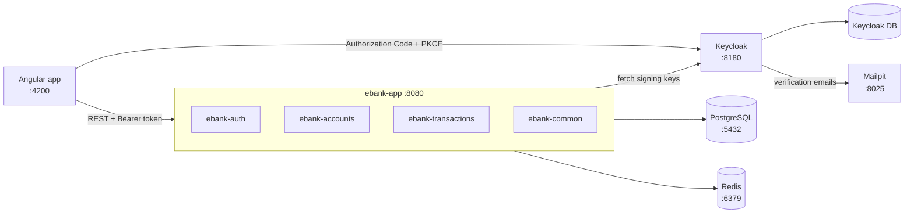
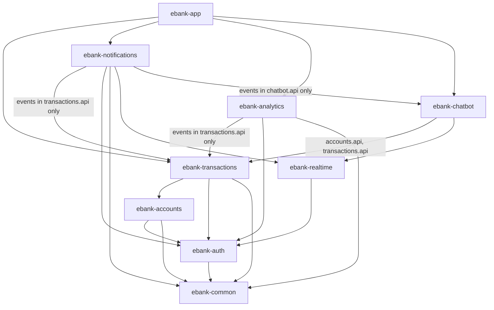
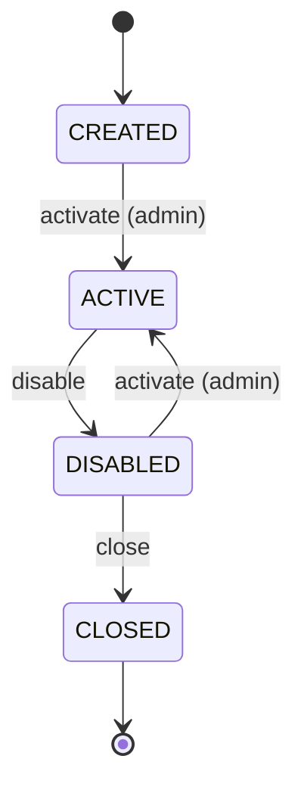

# EBANK

A banking application built as a **modular monolith**: a Spring Boot backend, an Angular front end, and Keycloak as the identity provider. It is a learning project for practising backend, frontend, DevSecOps and observability concepts on a realistic domain.

This README describes how the project works today. For the design rationale and full roadmap, see [project.md](project.md).

## Contents

- [Project status](#project-status)
- [Tech stack](#tech-stack)
- [Architecture](#architecture)
- [Repository layout](#repository-layout)
- [Getting started](#getting-started)
- [Configuration](#configuration)
- [Security](#security)
- [Domain rules](#domain-rules)
- [REST API](#rest-api)
- [Database](#database)
- [Front end](#front-end)
- [Testing](#testing)
- [Observability](#observability)
- [Docker images](#docker-images)
- [Deploying to k3s](#deploying-to-k3s)
- [CI/CD and security scans](#cicd-and-security-scans)
- [Conventions](#conventions)
- [Troubleshooting](#troubleshooting)

## Project status

| Area | State |
|---|---|
| `ebank-common`, `ebank-auth`, `ebank-accounts`, `ebank-transactions` | Implemented and tested |
| `ebank-notifications` | Implemented and tested: stored notifications, REST API, live push over WebSocket/STOMP, email fallback for offline users |
| `ebank-analytics` | Implemented and tested: transaction events projected into Elasticsearch, per-user summary, timeline and counterparties, admin overview |
| Transactional outbox | Implemented in `ebank-common`. Delivered by an in-process relay by default, or through RabbitMQ (one queue per handler, dead-letter queues) when turned on. Each handler succeeds or fails on its own. |
| Front end: sign-in, accounts, transactions, profile, theming | Implemented against the real API |
| Front end: notifications | On the notifications API, pushed live over STOMP, read state stored by the backend, email and SMS preferences |
| Front end: chat | On the chat API and STOMP: assistant, handoff, read receipts. Advisor console at `/advisor`. Text only until attachments exist in the backend (phase 8c). |
| Front end: analytics | On the analytics API: summary, in and out chart, top counterparties, bank overview for admins |
| Front end: configuration | Read at startup from `/config.json`, rendered per environment by nginx, so one image runs everywhere |
| `ebank-chatbot` | Implemented and tested (phases 7 and 8b): Claude assistant with read-only tools, advisor handoff, queue, live text chat, read receipts |
| `ebank-realtime` | The one STOMP connection per user, shared by notifications and chat |
| Chat files, audio messages, 1:1 calls (phases 8c and 8d) | Not implemented: no MinIO, ClamAV, coturn or WebRTC signaling yet |
| Message broker | RabbitMQ as an optional outbox transport (`EBANK_OUTBOX_RABBITMQ_ENABLED`), off by default. No STOMP broker relay yet, so still one backend replica. |
| SMS provider | Not implemented. SMS is a logging stub. |
| Ledger export | Admin CSV export of the entries of closed days (`GET /api/v1/ledger/export`) |
| Redis | Rate limits for the chat. Configured as the Spring cache, which no code uses yet. |
| `infra/observability` | Prometheus with alert rules (unit-tested with promtool) and SLO burn-rate alerts, Alertmanager (alerts emailed to Mailpit locally), runbooks in [docs/runbooks](docs/runbooks), Grafana dashboard, OpenTelemetry collector and Jaeger, ELK for logs (compose profile `observability`). In k3s: kube-prometheus-stack, Loki and Alloy ([infra/observability/k8s](infra/observability/k8s)). |
| `infra/helm` | Helm chart for k3s, with dev, qua and prod values |
| `infra/vault` | Vault holds the config and secrets of every environment: the backend reads it with Spring Cloud Vault, External Secrets Operator serves the other pods ([ADR 0001](docs/adr/0001-vault-single-source.md)). Compose runs a dev Vault seeded from git. Optional: dynamic PostgreSQL credentials; prod: three servers and transit auto-unseal; metrics and alerts. |
| `infra/ci` | Jenkins pipeline, SonarQube, security scans (gitleaks, Semgrep, Trivy, OWASP ZAP), SBOMs, image signing with cosign once a key is set up |

## Tech stack

| Area | Technology |
|---|---|
| Backend | Java 21, Spring Boot 4.1.2 (Spring MVC with virtual threads), Maven multi-module |
| Persistence | PostgreSQL 18, Spring Data JPA, Flyway |
| Cache | Redis 8 |
| Mapping | MapStruct, with records for DTOs |
| API docs | springdoc-openapi |
| Identity | Keycloak 26, Spring Security OAuth2 Resource Server |
| Front end | Angular 21 (standalone components, signals), `keycloak-js`, SCSS |
| Tests | JUnit 5, ArchUnit, Testcontainers, Vitest |
| Runtime | Docker, Docker Compose (local development only), nginx for the front end |

## Architecture

All backend modules are packaged into one deployable jar by `ebank-app`, which holds the entry point, configuration and integration tests. Keycloak handles registration, login, password reset and MFA. The backend only validates tokens, so it has no `users` table and no login endpoints.



### Module dependencies



### Module boundaries

Modules only talk through public APIs, never through each other's classes or tables. `ModuleBoundariesTest` enforces the following with ArchUnit, so a violation fails the build:

- `transactions` may only use the `com.ebank.accounts.api` package of `accounts`, not its `application`, `domain`, `infrastructure` or `web` packages.
- `accounts` must not depend on `transactions`.
- `accounts` and `transactions` must not depend on `com.ebank.auth.security`. They use the `CurrentUser` interface from `com.ebank.auth.api`.
- `common` must not depend on `accounts`, `transactions`, `auth` or `notifications`.
- `notifications` may only use the event records in `com.ebank.transactions.api`, and nothing from `accounts`.
- `accounts` and `transactions` must not depend on `notifications`: they publish events and don't know who listens.
- `analytics` may only use the event records in `com.ebank.transactions.api`, nothing from `accounts` or `notifications`, and no module depends on `analytics`.
- `chatbot` may only use the public `api` packages of `accounts`, `transactions`, `auth` and `realtime`. Its tools reach banking data through `AccountsApi.accountsOwnedBy` and `TransactionsApi` only.
- `notifications` may only use the event records in `com.ebank.chatbot.api`, and nobody uses `com.ebank.realtime.stomp`.

The public APIs are:

| Interface | Purpose |
|---|---|
| `AccountsApi` | Check account access, list a user's account IDs, lock accounts for a transaction |
| `AccountClosingGuard` | Lets another module veto closing an account, without `accounts` depending on it. `transactions` implements it to refuse closing an account that still holds money. |
| `CurrentUser` | The authenticated caller: user ID and admin check |
| `TokenAuthenticator` | Validates an access token outside HTTP (STOMP `CONNECT`), with the same checks and role mapping |
| `Outbox` / `OutboxEventHandler` | Publish a domain event in the current transaction / consume one type of event |
| `TransactionCompleted`, `TransactionCancelled` | Events published by `transactions` through the outbox |
| `AccountsApi.accountsOwnedBy`, `TransactionsApi` | Read-only, owner-scoped queries for callers outside a request (the chat assistant). The user ID always comes from a verified token. |
| `RealtimeMessaging`, `UserQueue` | Push to a user's `/user/queue/...`; a module declares a `UserQueue` bean to allow subscriptions to it |
| `AdvisorMessageSent`, `HandoffRequested` | Events published by `chatbot`: notify a customer who is away, alert advisors when nobody is online |

Domain modules use the same package layout: `api` (public), `application`, `domain`, `infrastructure` and `web`.

## Repository layout

```text
.
├── backend/                  Maven multi-module project
│   ├── ebank-app/            Entry point, config, Flyway baseline, integration and architecture tests
│   ├── ebank-common/         Money, RFC 9457 error handling, pagination, transactional outbox, scheduler
│   ├── ebank-auth/           Security config, Keycloak role mapping, CurrentUser
│   ├── ebank-accounts/       Accounts, lifecycle, modification history
│   ├── ebank-transactions/   Transfers, deposits, ledger, balances, search
│   ├── ebank-notifications/  Notifications, preferences, WebSocket push, email/SMS fallback
│   ├── ebank-analytics/      Transaction facts in Elasticsearch, summaries and timelines
│   ├── ebank-realtime/       WebSocket/STOMP: JWT on CONNECT, per-module user queues, presence
│   └── ebank-chatbot/        Assistant (Claude + tools), conversations, advisor handoff and chat
├── front-web/                Angular application
├── infra/
│   ├── compose/              docker-compose.yml for local development
│   ├── docker/               Dockerfiles and nginx config
│   ├── keycloak/realms/      Versioned "ebank" realm, applied by keycloak-config-cli on every start and deploy
│   ├── helm/ebank/           Helm chart for k3s: templates/, values.yaml, values-{dev,qua,prod}.yaml, files/ (links to shared config)
│   ├── vault/                Vault layout: policies, per-environment config, apply.sh, database/, k3s install values and scripts
│   ├── rabbitmq/             RabbitMQ config, shared by compose and the chart
│   ├── ci/                   jenkins/ (Jenkinsfile, agent), sonarqube/, security/ (scan.sh and rules), cosign/, deploy and signing scripts
│   ├── observability/        prometheus/ (rules and their tests), alertmanager/, grafana/, otel/, elk/, k8s/ (kube-prometheus-stack, Loki, Alloy)
│   └── scripts/              End-to-end test scripts and a STOMP client
├── docs/                     adr/ (architecture decisions), runbooks/, manual test guide
└── project.md                Design decisions and roadmap
```

## Getting started

### Prerequisites

- Docker with Compose. This is the only requirement to run the full stack.
- JDK 21 to build the backend outside Docker. The Maven wrapper is included.
- Node.js 24 (the version the front-end image builds with) and npm to work on the front end.

### Run the full stack

```bash
cd infra/compose
docker compose --profile app up -d --build --wait
```

To work on the backend or front end from your own machine, start only the infrastructure:

```bash
cd infra/compose
docker compose up -d --wait
```

| Service | URL | Credentials | Started by |
|---|---|---|---|
| Front end | http://localhost:4200 | Register in the app | `--profile app` |
| Backend API | http://localhost:8080/api/v1 | Bearer token | `--profile app` |
| Swagger UI | http://localhost:8080/swagger-ui.html | Public in `dev` | `--profile app` |
| Keycloak admin console | http://localhost:8180 | `admin` / `admin` | Always |
| Mailpit (test inbox) | http://localhost:8025 | None | Always |
| PostgreSQL | `localhost:5432`, database `ebank` | `ebank` / `ebank` | Always |
| Redis | `localhost:6379` | None | Always |
| Elasticsearch (analytics) | http://localhost:9200 | None, security off in dev | Always |
| Vault (config and secrets) | http://localhost:8200 | Root token `dev-root-token` | Always, seeded by `vault-seed` from [infra/vault/local](infra/vault/local) |

These defaults are for local containers only. To override them, create `infra/compose/.env`, which git ignores.

### Run the backend locally

Start the infrastructure first, then:

```bash
cd backend
./mvnw -DskipTests package
SPRING_PROFILES_ACTIVE=dev java -jar ebank-app/target/ebank-app-0.0.1-SNAPSHOT.jar
```

No profile is active by default, so `SPRING_PROFILES_ACTIVE` is required. The `dev` profile's defaults point at the Compose services.

### Run the front end locally

```bash
cd front-web
npm ci
npm start
```

The app is served on http://localhost:4200. Stop the `front-web` container first if it is running, because they use the same port. Don't move the app to another port: the Keycloak client and the backend's CORS config only allow this origin.

### Create test users and data

The realm has no seeded users, and new accounts start out unusable, so a first run takes a few steps:

1. **Register a customer** from the app, then open the verification email in Mailpit. New users get the `CUSTOMER` role automatically.
2. **Create an admin.** Register a second user, then in the Keycloak admin console open the `ebank` realm and assign that user the `ADMIN` realm role. Admins must set up TOTP to sign in.
3. **Create an account** as the customer. Its status is `CREATED`.
4. **Activate the account** as the admin (`PATCH /accounts/{accountId}/activate`).
5. **Fund the account** as the admin (`POST /transactions/deposits`). Deposits are the only way to bring money into the system.

Customers can then transfer between active accounts that use the same currency.

### Stop the stack

```bash
cd infra/compose
docker compose --profile app down        # keeps data
docker compose --profile app down -v     # also deletes all databases and Keycloak users
```

The realm is applied again by `keycloak-config` on every `docker compose up`, so changes to `ebank-realm.json` take effect without deleting the volumes. Users, and clients that are not in the file (such as the test scripts' `ebank-cli`), are kept.

## Configuration

Shared settings are in [application.yml](backend/ebank-app/src/main/resources/application.yml). Each environment has its own profile file.

| Behaviour | `dev` | `qua` | `prod` |
|---|---|---|---|
| Connection settings | Default to local containers | Required, startup fails if missing | Required, startup fails if missing |
| Swagger UI and API docs | Public | Public | Disabled |
| Actuator port | 8080 | 8081 (internal) | 8081 (internal) |
| Public Actuator endpoints | All exposed | Health, info, Prometheus | Health, info, Prometheus |
| Trace sampling | 100%, export off by default | 100% | 10% |
| Log format | Plain text, `com.ebank` at `DEBUG` | ECS JSON | ECS JSON |

### Where the settings come from

[Vault](infra/vault/README.md) holds the config and the secrets of each environment (`ebank/<env>/backend/config` and `.../secrets`). With `VAULT_ENABLED=true`, the backend reads them at startup through Spring Cloud Vault. The keys are the variable names below, so the `${...}` placeholders of the profiles resolve from Vault, and a real environment variable still wins. Without Vault (the default, and for a backend started on the host), the variables below are read from the environment as before.

| Variable | Default | Description |
|---|---|---|
| `VAULT_ENABLED` | `false` | Load config and secrets from Vault |
| `VAULT_ADDR` | `http://localhost:8200` | Vault address |
| `VAULT_AUTHENTICATION` | `TOKEN` | `TOKEN` (with `VAULT_TOKEN`) or `KUBERNETES` (service account token, role `VAULT_ROLE`) |
| `VAULT_TOKEN` | Empty | Token auth, compose only (`local-backend-token`) |
| `VAULT_ROLE`, `VAULT_KUBERNETES_PATH`, `VAULT_KUBERNETES_TOKEN_FILE` | `ebank-backend`, `kubernetes`, the default service account token | Kubernetes auth. The chart projects a token for the `vault` audience. |
| `EBANK_ENV` | `dev` | Environment folder in Vault: `local`, `dev`, `qua` or `prod` |
| `VAULT_FAIL_FAST` | `false` in `dev`, `true` in `qua` and `prod` | Refuse to start when Vault can't be read |
| `VAULT_DATABASE_ENABLED` | `false` | Dynamic PostgreSQL credentials: a database user of its own from `database/creds/<role>`, renewed hourly and replaced before it expires. They come as `VAULT_DB_USERNAME` / `VAULT_DB_PASSWORD`, which the profiles read before `DB_USERNAME` / `DB_PASSWORD`. See [infra/vault/README.md](infra/vault/README.md#dynamic-database-credentials). |
| `VAULT_DATABASE_ROLE`, `VAULT_DATABASE_MOUNT` | `ebank-<EBANK_ENV>-backend`, `database` | Role and mount of the database engine |

### Environment variables

| Variable | Required in `qua`/`prod` | `dev` default | Description |
|---|---|---|---|
| `SPRING_PROFILES_ACTIVE` | Yes | None, also required in `dev` | `dev`, `qua` or `prod` |
| `DB_URL` | Yes | `jdbc:postgresql://localhost:5432/ebank` | JDBC URL |
| `DB_USERNAME` | Yes | `ebank` | Database user |
| `DB_PASSWORD` | Yes | `ebank` | Database password |
| `DB_POOL_SIZE` | No, `prod` only, defaults to 20 | Not used | Maximum Hikari pool size |
| `REDIS_HOST` | Yes | `localhost` | Redis host |
| `REDIS_PORT` | No, defaults to 6379 | `6379` | Redis port |
| `REDIS_PASSWORD` | Yes | Empty | Redis password |
| `REDIS_SSL_ENABLED` | No, defaults to `true` | Not used | Redis TLS |
| `KEYCLOAK_ISSUER_URI` | Yes | `http://localhost:8180/realms/ebank` | Must match the token's `iss` claim |
| `KEYCLOAK_JWK_SET_URI` | Yes | `http://localhost:8180/realms/ebank/protocol/openid-connect/certs` | Where signing keys are fetched from |
| `CORS_ALLOWED_ORIGINS` | Yes | `http://localhost:4200` | Allowed browser origins |
| `OTLP_TRACES_ENDPOINT` | Yes | `http://localhost:4318/v1/traces` | OTLP trace collector |
| `OTLP_TRACES_ENABLED` | No, `dev` only | `false` | Turns on trace export in `dev` |
| `MAIL_HOST` | Yes | `localhost` (Mailpit) | SMTP host for fallback emails |
| `MAIL_PORT` | No, defaults to 587 | `1025` | SMTP port |
| `MAIL_USERNAME` / `MAIL_PASSWORD` | Yes | Not used | SMTP credentials (STARTTLS required in `qua`/`prod`) |
| `MAIL_FROM` | Yes | `EBANK <noreply@ebank.local>` | Sender of fallback emails |
| `KEYCLOAK_URL` | Yes | `http://localhost:8180` | Keycloak base URL for the Admin API (email and phone lookup) |
| `KEYCLOAK_NOTIFICATIONS_CLIENT_SECRET` | Yes | `dev-notifications-secret` | Secret of the `ebank-notifications` service account. Empty turns email/SMS fallback off. |
| `ELASTICSEARCH_URIS` | Yes | `http://localhost:9200` | Analytics store |
| `ANTHROPIC_API_KEY` | Yes | Empty: scripted assistant | Claude API key for the chat assistant. Without it in `dev`, a keyword-based assistant answers with the same tools. |
| `ELASTICSEARCH_USERNAME` / `ELASTICSEARCH_PASSWORD` | Yes | Not used | Elasticsearch credentials |
| `EBANK_OUTBOX_RABBITMQ_ENABLED` | No, defaults to `false` | `false` | Deliver outbox events through RabbitMQ instead of in-process ([Outbox transports](#outbox-transports)) |
| `RABBITMQ_HOST`, `RABBITMQ_PORT`, `RABBITMQ_VHOST`, `RABBITMQ_SSL_ENABLED` | With the RabbitMQ transport | `localhost`, `5672`, `/`, `false` | Broker address |
| `RABBITMQ_USERNAME` / `RABBITMQ_PASSWORD` | With the RabbitMQ transport | `guest` / `guest` (RabbitMQ only accepts them from localhost) | Broker credentials |

Two issuer settings are needed because browsers and containers reach Keycloak at different addresses. Tokens always name `http://localhost:8180` as their issuer, while the backend container fetches keys from `http://keycloak:8080`.

## Security

### Authentication

- The front end signs in with **Authorization Code + PKCE (S256)** through the public client `ebank-web`. Tokens stay in memory, and a page reload restores them from the Keycloak SSO session.
- The backend is a **stateless OAuth2 Resource Server**. It checks each token's signature, expiry, issuer and audience, which must be `ebank-api`.
- The user ID is the token's `sub` claim.
- Access tokens last 5 minutes. Refresh tokens are single-use.
- Logout goes through Keycloak with no server-side denylist, so an access token stays valid until it expires (accepted risk).

### Authorization

Roles come from the token's `realm_access.roles` claim.

| Path | Access |
|---|---|
| Paths in `ebank.security.public-paths` | Public (varies by profile, see [Configuration](#configuration)) |
| Other `/actuator/**` paths | `ADMIN` |
| `/api/**` | Any authenticated user. Finer checks are in the business code. |
| Anything else | Denied |

Ownership is checked in the service layer:

- Customers only see and change their own accounts.
- Someone else's account returns the same `404` as one that does not exist, so account IDs can't be probed.
- Admins can read all accounts and transfers, but **can't send money from a customer's account**.

### Keycloak realm

The realm is versioned in [ebank-realm.json](infra/keycloak/realms/ebank-realm.json). [keycloak-config-cli](https://github.com/adorsys/keycloak-config-cli) applies it to the running Keycloak: the `keycloak-config` service in compose, and a Job after every `helm upgrade` in k3s. It's idempotent and creates or updates what the file describes, so every environment gets the same realm. What differs per environment is a `$(env:...)` placeholder:

| Placeholder | compose | k3s |
|---|---|---|
| `EBANK_APP_URL` (redirect URIs, web origin, logout) | `http://localhost:4200` | From `hosts.app` |
| `KEYCLOAK_NOTIFICATIONS_CLIENT_SECRET` | `dev-notifications-secret` | Vault `ebank/<env>/keycloak` |
| `KEYCLOAK_SMTP_HOST`, `_PORT`, `_FROM` | Mailpit | Vault `ebank/<env>/keycloak/config` |

The OTP flows nest one role condition per sub-flow (`ebank-advisor-otp` → `ebank-advisor-otp-not-admin`, `ebank-customer-otp` → `ebank-customer-otp-not-advisor`), because keycloak-config-cli cannot manage a flow with the same authenticator twice. [auth.spec.ts](front-web/e2e/auth.spec.ts) and the chat test check the result through real sign-ins.

| Setting | Value |
|---|---|
| Clients | `ebank-web` (public, PKCE), `ebank-api` (bearer-only, used as the audience), `ebank-notifications` (confidential service account with `view-users` and `view-realm`, to read email and phone and list advisors; needs the `kc-admin-api` scope on Keycloak 26.8+) |
| Roles | `CUSTOMER` (default for new users), `ADVISOR` (answers customers in the chat, no direct access to banking data), `ADMIN` |
| MFA | TOTP required for `ADMIN` and `ADVISOR`, optional for `CUSTOMER` |
| Registration | Open, with email verification. Password reset enabled. |
| Password policy | At least 12 characters (128 at most), not the username or email, not one of the last 3 passwords, PBKDF2 with 210,000 iterations |
| Protection | Brute-force detection on, login and admin events recorded |

The password grant is disabled on `ebank-web`, so you can't get a token with a direct `curl` login. To call the API by hand, sign in through the app and copy the bearer token from a request in the browser's developer tools.

## Domain rules

### Accounts

An account has an internal UUID and a public `accountId`, which is IBAN-like: `EB`, two check digits (ISO 7064 mod 97), then 20 random digits. `EB` is not a real country code, so these can't be mistaken for real IBANs.



- Types are `SAVING`, `CURRENT` and `CRYPTO`. A `CRYPTO` account needs a crypto currency, and the others need a fiat currency.
- Closing is a soft delete: the row and its history stay. An account must be `DISABLED` and have a zero balance to be closed.
- A closed account can't be changed, and its status is final.
- Every change is written to `account_history` with the user who made it.

### Money

`Money` pairs a `BigDecimal` amount with a currency. It never uses `double`.

- Supported currencies are monetary ISO 4217 codes, plus `BTC` and `ETH`.
- Decimals are limited per currency (for example 2 for EUR, 8 for crypto). An amount with too many decimals is **rejected, never rounded**.
- Amounts can have up to 18 integer digits.

### Transfers and the ledger

Balances are never stored. An account's balance is the sum of its ledger entries, and each completed transfer writes exactly one `DEBIT` and one `CREDIT`. A deposit is balanced by a technical `EXTERNAL-<currency>` ledger account, for example `EXTERNAL-EUR`.

A transfer runs in one database transaction with a 10-second timeout:

1. Validate the amount and check for an earlier request with the same idempotency key.
2. Lock both accounts with `SELECT ... FOR UPDATE`, always in the same order to avoid deadlocks.
3. Check that the sender belongs to the caller and is active, and that both accounts are active and use the transfer's currency.
4. Check the idempotency key again, because a duplicate may have finished while this request waited for the lock.
5. Save the transfer, then either post the ledger entries (`DONE`) or, without enough funds, mark it `CANCELLED` with no ledger entries.

Locking is what keeps the balance check safe: without it, two simultaneous debits could both pass. The integration tests cover this case.

Customers see everything sent from their accounts, but only completed transfers they received. A cancelled transfer stays hidden from the receiver because it would reveal that the sender lacked funds.

### Idempotency

`POST /transactions` and `POST /transactions/deposits` require an `Idempotency-Key` header of 1 to 128 characters. Keys are unique per user and enforced by a database constraint.

| Situation | Result |
|---|---|
| New key | `201 Created` |
| Same key, same request, original succeeded | `200 OK` with `Idempotency-Replayed: true`. No money moves. |
| Same key, same request, original was cancelled | The same `422 INSUFFICIENT_FUNDS` |
| Same key, different request | `422 IDEMPOTENCY_KEY_REUSED` |

## REST API

The base path is `/api/v1`, and every endpoint needs a bearer token. Swagger UI has the full request and response schemas. List endpoints take `page` (default 0) and `size` (default 20, maximum 100).

### Accounts

| Method | Path | Description | Access |
|---|---|---|---|
| `GET` | `/accounts` | List accounts, newest first | Own accounts, or all for an admin |
| `POST` | `/accounts` | Create an account | Authenticated user |
| `GET` | `/accounts/{accountId}` | Get an account | Owner or admin |
| `PUT` | `/accounts/{accountId}` | Change the account type | Owner or admin |
| `PATCH` | `/accounts/{accountId}/activate` | Activate or re-enable | **Admin only** |
| `PATCH` | `/accounts/{accountId}/disable` | Disable | Owner or admin |
| `PATCH` | `/accounts/{accountId}/close` | Close (soft delete) | Owner or admin |
| `GET` | `/accounts/{accountId}/history` | Modification history, newest first | Owner or admin |
| `GET` | `/accounts/{accountId}/balance` | Balance computed from the ledger | Owner or admin |

### Transactions

| Method | Path | Description | Access |
|---|---|---|---|
| `POST` | `/transactions` | Transfer between two accounts | Owner of the sender account |
| `POST` | `/transactions/deposits` | Bring outside money into an account | **Admin only** |
| `GET` | `/transactions/{transactionId}` | Get a transfer | Visible to the caller |
| `GET` | `/transactions` | Search, newest first | Visible to the caller |

Search filters can be combined: `transactionId`, `accountId` (sender or receiver), `sender` and `receiver`.

### Ledger export

| Method | Path | Description | Access |
|---|---|---|---|
| `GET` | `/ledger/export?from=yyyy-MM-dd&to=yyyy-MM-dd` | Every ledger entry booked on these UTC days, as CSV, oldest first | **Admin only** |

For accounting and reconciliation. Only closed days (up to yesterday, UTC) and at most 31 days: entries are never changed, so two exports of the same range are identical. Columns: `entry_id,transfer_id,transaction_id,account_id,type,amount,currency,booked_at`; debits and credits balance for every transfer and deposit. The `X-Ledger-Entry-Count` header gives the number of rows. Rows are streamed from a database cursor, so a long range does not load into memory. Errors (422): `INVALID_RANGE`, `RANGE_TOO_LONG`, `DAY_NOT_CLOSED`. Each export is logged with the admin's user ID.

```bash
curl -H "Authorization: Bearer $ADMIN_TOKEN" -o ledger.csv \
  "http://localhost:8080/api/v1/ledger/export?from=2026-11-01&to=2026-11-13"
```

Example transfer:

```bash
curl -X POST http://localhost:8080/api/v1/transactions \
  -H "Authorization: Bearer $TOKEN" \
  -H "Content-Type: application/json" \
  -H "Idempotency-Key: $(uuidgen)" \
  -d '{
    "senderAccountId": "EB...",
    "receiverAccountId": "EB...",
    "amount": 25.50,
    "currency": "EUR",
    "reference": "Rent"
  }'
```

### Errors

Errors follow [RFC 9457](https://www.rfc-editor.org/rfc/rfc9457) `ProblemDetail`, with a stable `code` property for clients to match on. Validation errors also include a `violations` list.

```json
{
  "title": "Unauthorized",
  "status": 401,
  "detail": "A valid access token is required.",
  "instance": "/api/v1/accounts",
  "code": "UNAUTHORIZED"
}
```

| Status | Codes |
|---|---|
| 400 | `VALIDATION_FAILED` |
| 401 | `UNAUTHORIZED` |
| 403 | `FORBIDDEN` |
| 404 | `ACCOUNT_NOT_FOUND`, `TRANSACTION_NOT_FOUND` |
| 409 | `INVALID_ACCOUNT_STATUS`, `ACCOUNT_BALANCE_NOT_ZERO`, `CONCURRENT_MODIFICATION`, `CONFLICT` |
| 422 | `INVALID_AMOUNT`, `UNSUPPORTED_CURRENCY`, `CURRENCY_MISMATCH`, `CURRENCY_TYPE_MISMATCH`, `SAME_ACCOUNT`, `ACCOUNT_NOT_ACTIVE`, `RECEIVER_NOT_AVAILABLE`, `INSUFFICIENT_FUNDS`, `IDEMPOTENCY_KEY_REUSED` |
| 500 | `INTERNAL_ERROR` |
| 503 | `SERVICE_UNAVAILABLE` |

### Notifications

| Method | Path | Description | Access |
|---|---|---|---|
| `GET` | `/notifications` | List, newest first. `unreadOnly=true` filters. Paged. | Own only |
| `GET` | `/notifications/unread-count` | `{"count": n}` | Own only |
| `PATCH` | `/notifications/{id}/read` | Mark one as read | Own only, 404 otherwise |
| `POST` | `/notifications/read-all` | Mark all as read, returns `{"updated": n}` | Own only |
| `GET` / `PUT` | `/notifications/preferences` | `{"emailEnabled", "smsEnabled"}`. Defaults: email on, SMS off. | Own only |

Types: `TRANSFER_RECEIVED`, `TRANSFER_SENT`, `TRANSFER_INTERNAL` (between two of the user's own accounts) and `TRANSFER_CANCELLED` (refused, for example for insufficient funds; only the sender is told).

**Live push.** Connect a STOMP client to `ws://<host>/ws`, send the token in the `CONNECT` frame's `Authorization: Bearer ...` header, and subscribe to `/user/queue/notifications`. Each frame is the same JSON as a list item.

- Only that subscription is allowed. Any other `SUBSCRIBE` or `SEND` closes the connection.
- The connection is closed with code `4001` when its token expires. Before that, send a fresh token for the same user as a `SEND` to `/app/token` with an `Authorization` header, or reconnect.
- The handshake only accepts origins listed in `CORS_ALLOWED_ORIGINS`.

**Flow.** `transactions` writes `TransactionCompleted` or `TransactionCancelled` to `outbox_event` in the transfer's own transaction. The relay delivers each event to `notifications` in a new transaction. If the user is subscribed, the notification is pushed after commit. If not, a `notifications.FallbackRequested` event is written to the outbox, and its handler emails (or texts) the user based on their preferences. Emails only go to a verified address, mask account IDs and never include the transfer reference. Mail is skipped if the notification was read in the meantime, and replaced by a push if the user has come online.

### Analytics

| Method | Path | Description | Access |
|---|---|---|---|
| `GET` | `/analytics/summary` | Per currency: incoming, outgoing, internal (between own accounts), net, refused transfers. `accountId` narrows to one account, where internal moves count as incoming or outgoing. | Own transactions only |
| `GET` | `/analytics/timeline` | Incoming, outgoing and net per `DAY`, `WEEK` or `MONTH` (`interval`), empty periods included. `currency` is required. | Own transactions only |
| `GET` | `/analytics/counterparties` | Top accounts paid (`direction=OUTGOING`) or paid by (`INCOMING`), `limit` 1-20, default 5. Money from outside the bank shows as `EXTERNAL-<currency>`. | Own transactions only |
| `GET` | `/analytics/overview` | Bank-wide per currency: transfers, deposits, refused transfers, active users (approximate). No per-customer figures. | **Admin only** |

All take `from` and `to` as inclusive UTC days (`yyyy-MM-dd`), the last 30 days by default, at most 366 days. Amounts are decimals at the currency's scale. Errors: `INVALID_RANGE`, `RANGE_TOO_LONG`, `UNSUPPORTED_CURRENCY`, `INVALID_LIMIT` (422), and `ANALYTICS_UNAVAILABLE` (503) while Elasticsearch is down.

**How it works.** The `TransactionCompleted` and `TransactionCancelled` events are projected into the `ebank-transactions` alias (index `ebank-transactions-v1`, strict mapping, separate from log indices). There is one document per transaction ID, so a redelivered event overwrites itself. Amounts are stored as `long` minor units (cents, satoshis), so sums are exact up to 2^53 minor units. Documents carry account IDs and user IDs, but never the free-text reference or any name or email. A user only matches documents listing them in `participants`, and a refused transfer only lists its sender. Figures are eventually consistent, about 1–2 s behind the ledger. Elasticsearch being down never blocks transfers or notifications: the analytics handler retries on its own.

**Rebuilding.** The index is a projection. To rebuild it, delete it and replay the events still in the outbox (published events are kept 7 days). Older figures can be checked against the [ledger export](#ledger-export); rebuilding the index from it is not automated.

### Chat

Customers, under `/chat/conversations`:

| Method | Path | Description |
|---|---|---|
| `POST` | `/chat/conversations` | The open conversation, or a new one (one open conversation per customer) |
| `GET` | `/chat/conversations`, `/{id}` | List (paged) or one |
| `GET` | `/{id}/messages?afterSeq=` | Messages after a sequence number, oldest first: use it to catch up after a reconnect |
| `POST` | `/{id}/messages` | `{"clientMessageId", "text"}`, at most 2000 characters. 201, or 200 when the same `clientMessageId` was already sent. In `BOT` state the assistant replies in the background. |
| `DELETE` | `/{id}/messages/{messageId}` | Soft-delete your own message |
| `POST` | `/{id}/handoff`, `/{id}/back-to-bot`, `/{id}/resolve` | Talk to an advisor, go back to the assistant, close |
| `POST` | `/{id}/read` | `{"seq"}`: read receipt, pushed to the other side |

Advisors (`ADVISOR` role), under `/advisor`: `GET /queue` (waiting conversations with the assistant's summary), `GET /conversations` (assigned to me), `GET /conversations/{id}` and `/messages` (whole transcript, assistant part included), `POST /conversations/{id}/claim` (409 `ALREADY_ASSIGNED` if another advisor was faster), `/messages`, `/resolve` and `/read`. An advisor only sees waiting conversations and their own.

States: `BOT → WAITING_ADVISOR → WITH_ADVISOR → RESOLVED`. The customer can go back to `BOT` from the queue or after resolution. Live events (`MESSAGE`, `STATE`, `READ`, `DELETED`, `TYPING`, `QUEUE`) are pushed on `/user/queue/chat`. An advisor counts as online while subscribed to it, and only then do conversations get assigned to them automatically (the least busy advisor first). With nobody online, the customer is told so, the conversation stays queued and advisors get an email, at most one every 5 minutes.

**Assistant.** `claude-opus-5-5` with effort `low`, through the official Anthropic Java SDK and a manual tool loop (at most 6 tool turns). Server-side refusal fallbacks are on (`fallbacks: "default"`). The tools are `list_accounts`, `get_balance`, `list_recent_transactions` and `escalate_to_advisor`. The first three are read-only; the last only changes the conversation state.

- The customer's user ID is fixed from their token when the tool session starts. Nothing the model sends can change it.
- The model sees accounts as `account_1`, `account_2`... plus their last 4 characters, never full account numbers.
- Email addresses, account, card and phone numbers that customers type are masked before their text is sent.
- The system prompt treats customer messages and tool results as data.
- Every tool call, handoff, assignment and resolution is written to `chatbot_audit`, without content or arguments.
- Rate limits use Redis: 20 messages a minute, 10 new conversations and 5 handoffs an hour.

Without `ANTHROPIC_API_KEY`, a scripted assistant (English and French keywords) uses the same tools.

## Database

Flyway owns the schema, and Hibernate only validates it (`ddl-auto: validate`).

| Table | Module | Contents |
|---|---|---|
| `accounts` | `accounts` | Accounts, with a `version` column for optimistic locking |
| `account_history` | `accounts` | Audit trail of account changes |
| `transfers` | `transactions` | Transfers, with unique `(initiated_by, idempotency_key)` |
| `ledger_entries` | `transactions` | Debit and credit entries, unique per `(transfer_id, type)` |
| `outbox_event` | `common` | Domain events waiting for delivery (`PENDING`), delivered (`PUBLISHED`, deleted after 7 days) or given up after 10 attempts (`FAILED`) |
| `outbox_event_handled` | `common` | Which handlers already processed an event, so a retry only re-runs the ones that failed |
| `notification` | `notifications` | One row per user and event, unique per `(source_event_id, user_id)` so a redelivered event never notifies twice |
| `notification_preference` | `notifications` | Offline channels per user. No row means the defaults. |
| `conversation` | `chatbot` | State, handoff reason, advisor, summary. At most one open conversation per customer (partial unique index). |
| `message` | `chatbot` | Per-conversation `seq` (gap-free: appended under a row lock), unique `(conversation_id, sender_id, client_message_id)` for idempotent sends, soft delete |
| `conversation_participant` | `chatbot` | Who is in a conversation and how far they have read |
| `chatbot_audit` | `chatbot` | Tool calls, handoffs, assignments, resolutions. No message content. |
| `outbox_event_handled` | `common` | Which outbox handlers already processed an event |

The outbox delivers **at least once**: handlers must be idempotent. Each handler runs in its own transaction, together with its row in `outbox_event_handled`, so handlers are independent. If analytics fails, notifications are still committed, and the retry only re-runs analytics. An event becomes `PUBLISHED` once all its handlers have succeeded. Failures are retried with exponential backoff (2 s, 4 s, ... up to 15 min). Events are claimed with `FOR UPDATE SKIP LOCKED` plus a 5-minute lease, so several instances can run the relay and no lock is held while handlers run. Only the exception type is stored in `last_error`, never its message.

To retry an event marked `FAILED` after fixing the cause: `UPDATE outbox_event SET status = 'PENDING', attempts = 0, next_attempt_at = now() WHERE id = '...';`

### Outbox transports

| | In-process (default) | RabbitMQ (`EBANK_OUTBOX_RABBITMQ_ENABLED=true`) |
|---|---|---|
| Delivery | `OutboxRelay` calls the handlers | `RabbitOutboxPublisher` publishes to the topic exchange `ebank.events` (routing key: the event type); each handler consumes its own quorum queue `ebank.<handler class>` |
| `PUBLISHED` means | every handler succeeded | the broker confirmed the message (publisher confirms) |
| A handler fails | the event is retried with back-off, up to 10 times, then `FAILED` | the message is retried 5 times (1 s, 2 s, 4 s, 8 s), then moves to `ebank.<handler class>.dlq` (`ebank_outbox_dead_letters{handler}`, alert `EbankOutboxDeadLetters`) |
| Duplicates | skipped through `outbox_event_handled` | the same: a redelivered message is acknowledged without running the handler again |

Both share the claim (`FOR UPDATE SKIP LOCKED` and lease), the back-off and the idempotency table, in `OutboxStore`. RabbitMQ only matters once handlers move to other services (a service consumes its queue), or when the broker should absorb bursts instead of PostgreSQL. With it on, `/actuator/health` includes the broker. Locally: `EBANK_OUTBOX_RABBITMQ_ENABLED=true docker compose --profile app --profile broker up -d --build --wait`; in k3s: `rabbitmq.enabled: true` (a single RabbitMQ node, user from Vault `ebank/<env>/rabbitmq`).

`transfers` and `ledger_entries` store account IDs as plain values with no foreign key to `accounts`, because modules don't reach into each other's tables.

### Adding a migration

Each module keeps its scripts in its own `src/main/resources/db/migration/<module>/` folder, and Flyway scans them all together. Versions are global across modules, so use a timestamp to avoid collisions:

```text
V<yyyyMMddHHmm>__<module>_<description>.sql
V202611081300__transactions_create_tables.sql
```

## Front end

The Angular app is in [front-web/](front-web/). It uses standalone components and signals, and each page is lazy-loaded.

```text
front-web/src/app/
├── core/       Auth (service, guards, interceptor), HTTP errors, layout shell, theme
├── features/   One folder per page: accounts, transactions, notifications, profile, chatbot, analytics, auth
└── shared/     Reusable components, models and pipes
```

| Route | Page | Access |
|---|---|---|
| `/auth` | Sign in and register, handed off to Keycloak | Signed-out users only |
| `/account` | Accounts (default page) | Signed in |
| `/transactions` | Transfers and search | Signed in |
| `/notifications` | Notifications | Signed in |
| `/profile` | Profile, with a link to the Keycloak account console | Signed in |
| `/chatbot` | Chat with the assistant, then an advisor | Signed in |
| `/advisor` | Advisor console: queue, assigned conversations, replies | `ADVISOR` role |
| `/analytics` | Money in and out, chart, counterparties; bank overview for admins | Signed in |

Implementation notes:

- **Tokens:** `authInterceptor` only attaches the token to requests under `apiUrl`, so it can't leak to another origin. It refreshes tokens that have under 30 seconds left.
- **Keycloak outages:** the app still starts and shows the sign-in page if Keycloak is unreachable.
- **Runtime configuration:** [main.ts](front-web/src/main.ts) loads `/config.json` (`apiUrl`, `wsUrl`, `keycloak.url`, `keycloak.realm`, `keycloak.clientId`) before Angular starts, and services read it through the `APP_CONFIG` token. `ng serve` uses [public/config.json](front-web/public/config.json). In the image, nginx renders it from [config.json.template](infra/docker/front-web/templates/config.json.template) and the `EBANK_*` variables, which also feed the CSP. Everything in it reaches the browser: never put a secret there.
- **Realtime:** [RealtimeService](front-web/src/app/core/realtime/realtime.service.ts) keeps the one STOMP connection per user (`@stomp/stompjs`). The token goes in the `CONNECT` frame, a fresh one is sent to `/app/token` every minute, and it reconnects every 5 s after a drop. Features call `watch('/user/queue/...')` and reload through REST after a reconnect, because pushes are best effort.
- **Notifications:** subscribed for the whole session, so the bell badge is live everywhere.
- **Chat presence:** the chat and the advisor console only subscribe to `/user/queue/chat` while they are on screen. That is what the backend counts as "in the chat" (customers) or "online" (advisors): an advisor who closes the console stops receiving new conversations, and a customer who left gets a notification for the advisor's reply.

## Testing

### Backend

Run these from `backend/`:

```bash
./mvnw test                        # Unit and architecture tests
./mvnw verify                      # Also runs integration tests (*IT), needs Docker
./mvnw -pl ebank-accounts -am test # One module and the modules it depends on
```

| Type | Location | Notes |
|---|---|---|
| Unit | `src/test` in each module | Domain rules and services |
| Architecture | `ModuleBoundariesTest` in `ebank-app` | Module boundaries, see [Module boundaries](#module-boundaries) |
| Integration | `AccountsIT`, `TransfersIT`, `LedgerExportIT`, `NotificationsIT`, `AnalyticsIT`, `OutboxIT`, `OutboxRabbitIT`, `ChatIT` in `ebank-app` | Full HTTP and STOMP requests against a real PostgreSQL through Testcontainers. `AnalyticsIT` also starts Elasticsearch, `OutboxRabbitIT` RabbitMQ (queues per handler, retries, dead-letter queue, redeliveries). Other ITs run with `ebank.analytics.enabled=false`. |
| Real Keycloak | `KeycloakIT` | The versioned realm in a real Keycloak 26.8: real signed tokens, issuer and JWKS, the `ebank-api` audience (another audience is 401), realm roles (CUSTOMER 403 / ADMIN 200), `sub` as the user ID, and a tampered signature |
| Vault | `VaultConfigIT` | The Vault part of `application.yml` against a real Vault: paths, precedence of environment variables, policy limits, Vault off, fail-fast |
| Dynamic database credentials | `DynamicDatabaseCredentialsIT` | Real Vault and PostgreSQL, with `infra/vault/database/setup.sql`, the role and the backend policy from the repository: a schema migrated by the static user handed over to `ebank_app`, the backend on its own user, the switch to a new user at `max_ttl` without a failed query, the old user dropped, the lease revoked on shutdown |
| SLO metrics | `SloMetricsIT` | The `le="1.0"` and `le="0.5"` buckets the latency SLO counts on exist in `/actuator/prometheus` |
| API contract | `OpenApiSpecIT` | Writes the served OpenAPI document to `target/openapi/ebank-api.json`, for `scan.sh api` |

The integration tests include concurrency scenarios: simultaneous debits never overdraw an account, opposite transfers don't deadlock, and simultaneous retries with one key move money once. They replace Keycloak with a test JWT decoder, except `KeycloakIT`, which covers the real token flow.

### End-to-end against the local stack

[test-notifications.sh](infra/scripts/test-notifications.sh) checks notifications with real Keycloak tokens, real WebSocket connections and real emails in Mailpit (37 checks, under a minute):

```bash
cd infra/compose && docker compose up -d --wait      # infrastructure
cd backend/ebank-app && ../mvnw spring-boot:run      # backend, dev profile
infra/scripts/test-notifications.sh                  # needs curl, jq, node 22+
infra/scripts/test-analytics.sh                      # 41 checks; stops Elasticsearch once (SKIP_OUTAGE=1 to skip)
infra/scripts/test-chat.sh                           # 38 checks: assistant, handoff, advisor, live assignment
```

[test-analytics.sh](infra/scripts/test-analytics.sh) books a deposit, a transfer, an internal move, a refused transfer and an incoming transfer. It then checks every analytics endpoint from both users' points of view and inspects the documents in Elasticsearch. Finally it stops Elasticsearch: analytics return 503 while transfers and notifications keep working, and the index catches up once Elasticsearch is back. Both scripts share [lib.sh](infra/scripts/lib.sh).

It creates new users on every run and, in your local Keycloak only, a public `ebank-cli` client with the password grant so curl can get tokens. That client is never in the versioned realm. Its direct grant skips the browser flow, including TOTP.

[stomp-client.mjs](infra/scripts/stomp-client.mjs) is a dependency-free STOMP client for trying `/ws` by hand:

```bash
node infra/scripts/stomp-client.mjs --token "$TOKEN"                    # print each pushed notification
node infra/scripts/stomp-client.mjs --token "$TOKEN" --subscribe /queue/x  # refused: ERROR, then CLOSED
```

### Front end

Run these from `front-web/`:

```bash
npx ng test --watch=false   # Single run with Vitest
npm test                    # Watch mode
npm run build               # Production build, enforces bundle size budgets
npm run e2e                 # Playwright, against the running local stack (see below)
```

[Playwright](front-web/playwright.config.ts) runs three journeys in Chromium against the real Keycloak, backend and front end:

| Test | Checks |
|---|---|
| [accounts.spec.ts](front-web/e2e/accounts.spec.ts) | Sign-in through the Keycloak page (PKCE), the funded account and its analytics, and no CSP violation in the console |
| [notifications.spec.ts](front-web/e2e/notifications.spec.ts) | A transfer received while the app is open bumps the bell live, and "mark all as read" sticks after a reload |
| [auth.spec.ts](front-web/e2e/auth.spec.ts) | MFA rules of the realm: a customer signs in with a password only, an admin must set up TOTP and then enter codes |
| [chat.spec.ts](front-web/e2e/chat.spec.ts) | The assistant answers a balance question, the customer asks for an advisor, the online advisor gets it, replies, sees "Seen", and resolves |

The tests create their own users through the Keycloak Admin API, plus the dev-only `ebank-cli` client for API calls. The advisor signs in through the browser with TOTP: the test sets up the authenticator from the secret Keycloak shows, then computes the codes. Without `E2E_BASE_URL` the config starts `ng serve`, which sends no security headers. To test the real image and its CSP, run the `front-web` container on port 4200 and set `E2E_BASE_URL=http://localhost:4200`. The browser comes from `npx playwright install chromium`.

## Observability

| Signal | How |
|---|---|
| Health | `/actuator/health/liveness` and `/actuator/health/readiness` |
| Metrics | `/actuator/prometheus`, with HTTP latency histograms and the `ebank_*` metrics below |
| Logs | Plain text in `dev`, ECS JSON on stdout in `qua`, `prod` and the compose backend, with `traceId` for jumping to the trace |
| Traces | OpenTelemetry over OTLP to the collector, then Jaeger. Metrics and logs are deliberately not sent over OTLP. |

`ebank_*` metrics: `security_rejections_total{status}`, `outbox_events{status}`, `outbox_oldest_pending_seconds`, `outbox_dead_letters{handler}` (RabbitMQ transport), `vault_database_credentials_expiry_seconds`, `vault_database_credentials_rotations_total{outcome}` (dynamic credentials), `notifications_recorded_total{type}`, `notifications_delivered_total{channel,outcome}`, `websocket_sessions`, `analytics_indexed_total{status}`, `chatbot_messages_total{sender}`, `chatbot_assistant_replies_total{outcome}`, `chatbot_tool_calls_total{tool,outcome}`, `chatbot_handoffs_total{reason}`, `chatbot_queue_wait_seconds`, `chatbot_llm_latency_seconds`.

Locally, `docker compose --profile observability up -d --wait` starts the stack from [infra/observability](infra/observability):

| Service | URL | What |
|---|---|---|
| Prometheus | http://localhost:9090 | Scrapes the backend in compose or on the host, Vault and RabbitMQ, and evaluates [the rules](infra/observability/prometheus/rules): backend down, heap, 401/403 spikes, outbox backlog, failures or dead letters, notification failures, assistant unavailable, slow advisor queue, database credentials ([ebank-alerts.yml](infra/observability/prometheus/rules/ebank-alerts.yml)); error and latency budgets ([ebank-slo.yml](infra/observability/prometheus/rules/ebank-slo.yml)); Vault and External Secrets ([vault-alerts.yml](infra/observability/prometheus/rules/vault-alerts.yml)) |
| Alertmanager | http://localhost:9093 | Receives Prometheus alerts, groups them, holds back the consequences of `EbankBackendDown`, and emails them to `ops@ebank.local` in Mailpit (http://localhost:8025) |
| Grafana | http://localhost:3000 (`admin` / `admin`) | Provisioned data sources (Prometheus, Alertmanager, Jaeger, logs) and the "EBANK overview" dashboard |
| Jaeger | http://localhost:16686 | Traces. Set `OTLP_TRACES_ENABLED=true` for the backend. |
| Kibana | http://localhost:5601 | Data views `ebank-logs-*` (logs, via Filebeat and Logstash) and `ebank-transactions` (analytics) |

Every alert has a `runbook_url` annotation pointing to its page in [docs/runbooks](docs/runbooks): what it means, how to check, how to fix and when to escalate. Add a page whenever you add an alert, and a case to [the promtool tests](infra/observability/prometheus/tests) (`scan.sh rules`).

**Service level objectives.** 99.5% of API requests without a 5xx and 99% within 1 s, over 30 days (actuator excluded; the 1 s histogram bucket is added in `application.yml`). Alerts fire on the error budget's burn rate, over a long and a short window at once (Google SRE workbook): `critical` when the month's budget would be gone in about two days (14.4x over 1 h, 6x over 6 h), `warning` when it would run out within the month (3x over 1 day, 1x over 3 days). Below one request a minute they stay silent. `ebank:slo_*:budget_remaining_30d` gives what is left. They replace the former fixed-threshold 5xx and p95 alerts.

**Kubernetes.** [infra/observability/k8s](infra/observability/k8s) has the values for kube-prometheus-stack (Prometheus, Alertmanager, Grafana), Loki and Alloy. With `monitoring.enabled: true` the chart adds ServiceMonitors, the same rule files as PrometheusRules and the dashboard, and the Vault chart its own ServiceMonitor. Logs go to Loki there (Alloy reads them through the Kubernetes API, no root or host path); compose keeps ELK.

Filebeat reads the logs of containers labelled `ebank-logs=true` (the compose backend). It needs root and the Docker socket, so it is for local use only. `/actuator/prometheus` needs no token because scrapers don't have one, so keep port 8081 private in `qua` and `prod`.

## Docker images

Both images use multi-stage builds, run as non-root users and are built by Compose with the correct build contexts.

| Image | Dockerfile | Notes |
|---|---|---|
| `ebank-backend` | [infra/docker/backend/Dockerfile](infra/docker/backend/Dockerfile) | One image layer per Spring Boot layer. The jar is extracted as `app.jar`, so a version bump doesn't change the entry point. Tests are skipped during the build. Exposes 8080 and 8081. Needs `SPRING_PROFILES_ACTIVE`. |
| `ebank-front-web` | [infra/docker/front-web/Dockerfile](infra/docker/front-web/Dockerfile) | nginx on port 8080, with the fallback route for the Angular app, long-lived caching for static assets, security headers and a `/healthz` endpoint. The config is rendered at startup from [templates](infra/docker/front-web/templates) into `/tmp/nginx`, so it works with a read-only root filesystem. |

## Deploying to k3s

[infra/helm/ebank](infra/helm/ebank) is a Helm 3 chart: PostgreSQL, Redis, Keycloak, backend, front end and a Traefik ingress, plus Elasticsearch and Mailpit when `devServices.enabled` is true (dev only). [values.yaml](infra/helm/ebank/values.yaml) holds the production-like defaults, and each environment overrides what differs in `values-dev.yaml`, `values-qua.yaml` or `values-prod.yaml`.

Every environment takes its config and secrets from Vault (`configSource: vault` in `values-{dev,qua,prod}.yaml`). Install Vault, External Secrets Operator and Reloader once, unseal Vault and apply the environment's layout as described in [infra/vault/README.md](infra/vault/README.md) (prod: three servers and transit auto-unseal, `vault-values-ha.yaml`). For `qua` and `prod`, also write their secrets in Vault by hand. For metrics, alerts and logs in the cluster, install [infra/observability/k8s](infra/observability/k8s) first and set `monitoring.enabled: true`. Then:

```bash
# dev: plain HTTP on *.ebank.localhost, realm imported
helm upgrade --install ebank infra/helm/ebank -n ebank-dev --create-namespace \
  -f infra/helm/ebank/values-dev.yaml \
  --set-file keycloak.realm=infra/keycloak/realms/ebank-realm.json

# qua / prod
helm upgrade --install ebank infra/helm/ebank -n ebank-prod --create-namespace \
  -f infra/helm/ebank/values-prod.yaml --set image.tag=<git sha> --wait

# Useful
helm template ebank infra/helm/ebank -f infra/helm/ebank/values-qua.yaml   # see what would be applied
helm -n ebank-prod history ebank                                           # releases
helm -n ebank-prod rollback ebank <revision>                               # go back
```

| Value | Default | Purpose |
|---|---|---|
| `image.registry`, `image.tag` | `docker.io/ebank`, chart `appVersion` | Backend and front-end images. CI sets the tag to the commit. |
| `hosts.app`, `hosts.api`, `hosts.auth` | `*.ebank.example` | Ingress hosts. The issuer URI, CORS origin and Keycloak hostname are derived from them. |
| `ingress.tls.enabled`, `ingress.tls.clusterIssuer` | `true`, empty | HTTPS on the `websecure` entrypoint; a cert-manager issuer adds the annotation. |
| `configSource` | `chart` (`vault` in the environment files) | `vault`: the backend reads Vault itself, and External Secrets Operator creates `ebank-postgres`, `ebank-redis`, `ebank-keycloak` and `ebank-front-web-config`. `chart`: the ConfigMap and hand-made Secrets of earlier versions. |
| `vault.address`, `vault.env`, `vault.refreshInterval` | `http://vault.vault:8200`, per file, `15m` | Where Vault is, the environment folder and roles (`ebank-<env>-backend`, `ebank-<env>-eso`), and how often ESO re-reads it |
| `vault.database.enabled`, `vault.namespace` | `false`, `vault` | Dynamic PostgreSQL credentials for the backend (run `infra/vault/k3s/enable-dynamic-db.sh <env>` first); a NetworkPolicy lets the Vault pods reach PostgreSQL |
| `rabbitmq.enabled` | `false` | RabbitMQ as the outbox transport: a single node, `ebank-rabbitmq` Secret from Vault (`ebank/<env>/rabbitmq`), backend credentials in `backend/secrets` |
| `monitoring.enabled`, `monitoring.vaultRules` | `false`, `true` | ServiceMonitors, PrometheusRules and dashboards for kube-prometheus-stack; the Vault rules in one release per cluster only |
| `image.digests` | empty | Image name to digest; set by `deploy.sh` once the cosign signature is verified, and preferred over the tag |
| `secrets.create` | `false` | `configSource: chart` only: `true` creates the three Secrets from `secrets.postgres`, `secrets.keycloak`, `secrets.backend`. |
| `backend.config` | see `values.yaml` | `configSource: chart`: the keys of the `ebank-backend-config` ConfigMap. With Vault, only `SPRING_PROFILES_ACTIVE` is used. |
| `backend.actuatorPort` | `management` | Probe and scrape port: `http` in dev, where actuator has no separate port. |
| `keycloak.devMode`, `keycloak.realm` | `false`, empty | `start-dev` instead of `start`; a realm passed with `--set-file` is imported on first start. |
| `devServices.enabled` | `false` | In-cluster Elasticsearch and Mailpit. |
| `networkPolicy.*` | enabled | Which namespaces may reach ports 8080 and 8081. |

Resource names are fixed (`backend`, `postgres`, `keycloak`...) because the backend config uses them as host names, so install one release per namespace. With Vault, Reloader restarts Redis, Keycloak and the front end when ESO updates their Secrets. The backend reads Vault at startup: after changing one of its values, restart it (`kubectl rollout restart deploy/backend`), or let the next deploy do it. In `configSource: chart`, `checksum/*` annotations restart the pods instead.

In `configSource: chart`, `ebank-backend-secrets` holds `DB_USERNAME`, `DB_PASSWORD`, `REDIS_PASSWORD`, `MAIL_USERNAME`, `MAIL_PASSWORD`, `KEYCLOAK_NOTIFICATIONS_CLIENT_SECRET`, `ELASTICSEARCH_USERNAME`, `ELASTICSEARCH_PASSWORD` and `ANTHROPIC_API_KEY`.

- **Backend: one replica on purpose.** The STOMP broker, presence and the assistant's per-conversation locks are in memory. Scaling out needs a broker relay first.
- **Backend: management port.** Probes and Prometheus use port 8081, which the ingress never routes. `NetworkPolicy` lets only Traefik reach 8080 and only the `monitoring` namespace reach 8081.
- **Pod hardening.** Every pod runs non-root, without privilege escalation, with all capabilities dropped and the `RuntimeDefault` seccomp profile. Root filesystems are read-only except Keycloak's and the dev Elasticsearch's. Service links are off: the `redis` Service would otherwise inject `REDIS_PORT=tcp://...`, which Spring reads as its port.
- **TLS.** prod gets certificates from cert-manager (`letsencrypt-prod` ClusterIssuer, installed separately).
- **Front end configuration.** The chart sets `EBANK_API_ORIGIN`, `EBANK_WS_ORIGIN` and `EBANK_KEYCLOAK_ORIGIN` from `hosts.*`, so `/config.json` and the CSP match each environment with the same image.

## CI/CD and security scans

[infra/ci/jenkins/Jenkinsfile](infra/ci/jenkins/Jenkinsfile) runs in an agent built from [agent.Dockerfile](infra/ci/jenkins/agent.Dockerfile) (JDK 21, Node 24, Docker CLI, kubectl, Helm, Vault CLI). It needs a SonarQube server named `sonarqube`, a `dockerhub` credential, and per environment (`dev`, `qua`, `prod`) a `kubeconfig-<env>` file credential and a `vault-approle-<env>` username/password credential (role ID / secret ID of AppRole `ebank-<env>-ci`). Prod deploys are approved by `ebank-release-managers`.

1. Secrets scan.
2. Backend and front end in parallel: `./mvnw -Pci verify` (all tests, JaCoCo coverage, CycloneDX SBOM, the served OpenAPI document) and `npm ci`, tests with coverage, build, npm SBOM.
3. SonarQube analysis and quality gate.
4. SAST, dependency, IaC and API contract checks in parallel.
5. Image build and scan.
6. On `master` only, the images built once are promoted unchanged: push, sign (once a key is set up, see [Image signing](#image-signing)), **deploy dev**, OWASP ZAP baseline on dev, **deploy qua**, approval, **deploy prod**.

Each deploy is [infra/ci/deploy.sh](infra/ci/deploy.sh) `<env>`, which can also be run by hand:

| Step | What happens | On failure |
|---|---|---|
| Vault | AppRole login (a 10-minute token that can only write this environment's config), then `infra/vault/apply.sh <env> --config-only` writes `infra/vault/<env>/*-config.json` | Stops before anything is deployed |
| Signatures | With `infra/ci/cosign/cosign.pub` committed: each image must have a valid signature and SBOM attestation, and is deployed by the verified digest | Stops before anything is deployed |
| Helm | `helm upgrade --install --atomic` with `values-<env>.yaml`, the image tag and the realm | Helm rolls back on its own if the pods don't get ready in time |
| Realm | The `keycloak-config` Job applies the realm | Fails the upgrade, so Helm rolls back |
| Smoke test | [smoke-test.sh](infra/ci/smoke-test.sh), from inside the cluster: backend health with database, Redis and Vault, `401` without a token, Keycloak realm and signing keys, the front end's `/config.json`. `SMOKE_URL` adds a check through the ingress. | `helm rollback` to the previous revision, and the stage fails |

These paths (the `--atomic` rollback, the rollback after a failed smoke test, AppRole and the writer policy) were checked on a throwaway k3d cluster. The Jenkinsfile itself parses as Groovy, but it hasn't run on a Jenkins server yet.

[infra/ci/security/scan.sh](infra/ci/security/scan.sh) runs the same scanners locally, each in a pinned container, and writes SARIF and HTML reports to `reports/`. It fails on HIGH and CRITICAL findings and on any leaked secret.

| Command | Tool | Checks |
|---|---|---|
| `scan.sh secrets` | gitleaks | Git history. Dev-only values are allow-listed in `gitleaks.toml`. |
| `scan.sh sast` | Semgrep | Community Java, TypeScript and secrets rules, plus [semgrep.yml](infra/ci/security/semgrep.yml): no `double` money, no logging of emails or content, no user ID from the request, no Angular sanitizer bypass, no wildcard CORS |
| `scan.sh deps` | Trivy | The backend SBOM (`target/classes/META-INF/sbom/application.cdx.json`, also served at `/actuator/sbom`) and `package-lock.json` |
| `scan.sh iac` | Helm, Trivy | `helm lint --strict`, then Dockerfiles, compose, and the chart rendered for each environment, one resource per file. Accepted findings, each with a reason, are in [.trivyignore.yaml](infra/ci/security/.trivyignore.yaml). |
| `scan.sh image <image>` | Trivy | OS packages and JARs of a built image |
| `scan.sh dast <url>` | OWASP ZAP | Passive baseline scan with [rules.tsv](infra/ci/security/zap/rules.tsv) |
| `scan.sh rules` | promtool, amtool | Alert rules: syntax and [unit tests](infra/observability/prometheus/tests) (burn rates, Vault, dead letters, credentials); the local Alertmanager config |
| `scan.sh api` | openapi-diff | [backend/openapi/ebank-api.json](backend/openapi/ebank-api.json) must match what the backend serves (run `./mvnw verify` first), so every API change shows in the pull request. It must also stay backward compatible with `origin/master` (the previous commit on `master`). After an intended change: `cp backend/ebank-app/target/openapi/ebank-api.json backend/openapi/`. A breaking change needs a new API version. |

The SBOM goal needs online mode: an offline build (`mvn -o`) silently skips it. To try SonarQube locally, start it with `docker compose -f infra/ci/sonarqube/compose.yml up -d`; the host needs `vm.max_map_count` of at least 262144.

### Image signing

[cosign](https://github.com/sigstore/cosign) signs the images after the push and attaches their CycloneDX SBOM as a signed attestation ([sign-images.sh](infra/ci/sign-images.sh)); `deploy.sh` verifies both and deploys the verified digest, so a tag moved in the registry afterwards changes nothing. Signatures are made with a key pair and no public transparency log ([signing-config.json](infra/ci/cosign/signing-config.json) lists no Rekor): nothing about the images is published, and verification works offline.

It turns on when the public key is committed. Once, by a release manager:

```bash
cosign generate-key-pair                    # asks for a password; writes cosign.key and cosign.pub
mv cosign.pub infra/ci/cosign/cosign.pub    # commit it (reviewed: it decides what may run)
# In Jenkins: "cosign-key" (secret file: cosign.key), "cosign-password" (secret text). Then delete cosign.key.
```

The check is only in the pipeline: someone with `kubectl` access can still run an unsigned image. To enforce it in the cluster as well, add an admission policy (Kyverno `verifyImages` or Sigstore's policy-controller) with the same public key.

### Front-end security headers

nginx sends these on every page and asset:

| Header | Value and reason |
|---|---|
| `Content-Security-Policy` | `script-src 'self'`: no inline script runs. `connect-src` and `frame-src` only allow the API and Keycloak origins, from `EBANK_API_ORIGIN`, `EBANK_WS_ORIGIN` and `EBANK_KEYCLOAK_ORIGIN` (set by compose and the Helm chart). `frame-ancestors 'self'` stops clickjacking. `style-src` keeps `'unsafe-inline'` because Angular inserts component styles at runtime. |
| `X-Frame-Options`, `X-Content-Type-Options`, `Referrer-Policy` | `SAMEORIGIN`, `nosniff`, `no-referrer` |
| `Permissions-Policy` | Camera, geolocation, payment and USB off. Microphone allowed for the app itself, for voice messages. |
| `Strict-Transport-Security` | One year. Browsers ignore it over plain HTTP, so local development is unaffected. |

To keep the policy strict, `index.html` and `silent-check-sso.html` load their scripts from files (`theme-init.js`, `silent-check-sso.js`), and the production build doesn't inline critical CSS, which would add an `onload` handler. A new inline script or event handler will be blocked: put it in a file.

### Dependency updates

Every version is pinned (Maven, npm, images in the Dockerfiles, compose, the Helm values and `scan.sh`). [renovate.json](renovate.json) makes Renovate propose the updates as pull requests every Monday morning, grouped per ecosystem. Major versions wait for approval in the dependency dashboard, and security fixes are proposed straight away. Renovate needs the Renovate GitHub app on the repository, or a self-hosted run.

## Conventions

- **Money:** always `Money` or `BigDecimal` with a currency, never `double`.
- **DTOs:** records, mapped with MapStruct. No Lombok.
- **Errors:** throw `ApiException` with a stable code, and let `GlobalExceptionHandler` build the response.
- **Logs:** no PII, tokens or secrets. Log internal IDs rather than user data.
- **Module access:** go through a module's `api` package, and add a rule to `ModuleBoundariesTest` when you add a module dependency.
- **Virtual threads:** avoid long `synchronized` blocks, which pin carrier threads on Java 21.
- **Cached values:** cache records, lists and sets. Packages outside the allowlist in `CacheConfig` can't be read back from Redis, and `Map.of(...)` values come back with an extra `@class` entry.

## Troubleshooting

| Symptom | Cause and fix |
|---|---|
| `mvnw`: "The JAVA_HOME environment variable is not defined correctly" | `JAVA_HOME` must point at the JDK folder, not the `java` binary, and must not contain curly quotes. |
| Integration tests fail with `NoSuchBeanDefinitionException` for a `*Mapper` | Leftover build output. Run `./mvnw clean verify`. |
| Integration tests can't start a container | Testcontainers needs a running Docker daemon. |
| Port already in use on `docker compose up` | Another service is on 4200, 5432, 6379, 8025, 8080 or 8180. Stop it. |
| API calls return `401` with a token that looks valid | Check that its `iss` is `http://localhost:8180/realms/ebank` and its `aud` includes `ebank-api`. A token from another hostname won't validate. |
| Keycloak login shows an invalid redirect URI | The app must run on `http://localhost:4200`. |
| Changes to `ebank-realm.json` have no effect | They are applied by `keycloak-config` (compose) or the `keycloak-config` Job (k3s). Check its logs: `docker compose logs keycloak-config`. |
| Verification email didn't arrive | All local email goes to Mailpit at http://localhost:8025. |
| Backend exits at startup outside `dev` | A required environment variable is missing. See [Environment variables](#environment-variables). |
| Maven fails with "cannot find symbol" on classes that exist, an empty record, or a missing `*Mapper` bean, while VS Code is open | The editor's Java builder writes stub classes into the same `target/` folder as Maven. Let the editor finish building, then run `./mvnw clean install` again. |
| Assistant only answers with the help text | No `ANTHROPIC_API_KEY`: the scripted assistant only knows a few keywords (balance, accounts, transactions, advisor). |
| No advisor alert email | The `ebank-notifications` service account needs `view-realm` to list advisors (`infra/scripts/lib.sh` adds it to an existing Keycloak). Alerts are sent at most once every 5 minutes. |
| Backend pod in k3s fails on `spring.data.redis.port` | Service links are on: the `redis` Service injects `REDIS_PORT=tcp://...`. Keep `enableServiceLinks: false`. |
