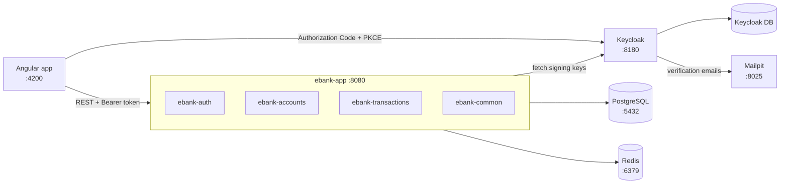
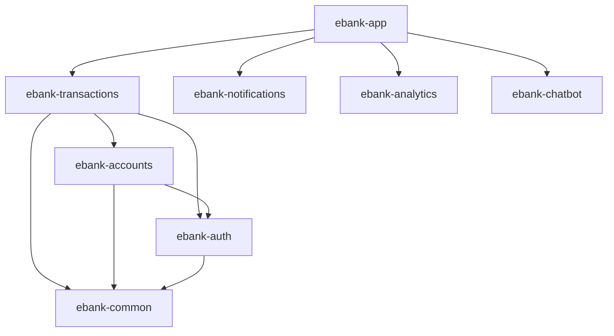
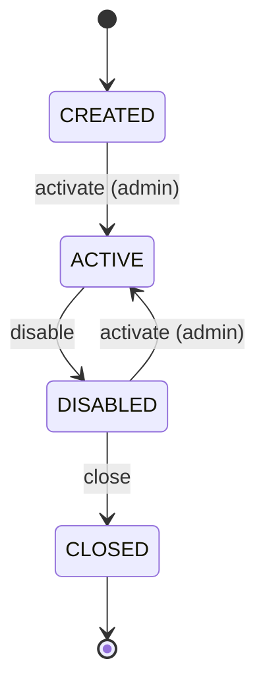

# EBANK

A banking application built as a **modular monolith**: a Spring Boot backend, an Angular front end, and Keycloak as the identity provider. It is a learning project for practising backend, frontend, DevSecOps and observability concepts on a realistic domain.

This README describes how the project works today. For the design rationale and full roadmap, see [project.md](project.md).

## Contents

- [Project status](#project-status)
- [Tech stack](#tech-stack)
- [Architecture](#architecture)
- [Repository layout](#repository-layout)
- [Getting started](#getting-started)
- [Configuration](#configuration)
- [Security](#security)
- [Domain rules](#domain-rules)
- [REST API](#rest-api)
- [Database](#database)
- [Front end](#front-end)
- [Testing](#testing)
- [Observability](#observability)
- [Docker images](#docker-images)
- [Conventions](#conventions)
- [Troubleshooting](#troubleshooting)

## Project status

| Area | State |
|---|---|
| `ebank-common`, `ebank-auth`, `ebank-accounts`, `ebank-transactions` | Implemented and tested |
| Front end: sign-in, accounts, transactions, profile, theming | Implemented against the real API |
| Front end: notifications | Works, but derived in the browser from recent transfers |
| Front end: chatbot | UI only, uses a simulated transport (`DemoChatTransport`) |
| Front end: analytics | Placeholder page |
| `ebank-notifications`, `ebank-analytics`, `ebank-chatbot` | Empty modules (folder structure only) |
| Transactional outbox, message broker | Not implemented |
| Redis | Configured as the Spring cache, but no code uses the cache yet |
| `infra/k3s`, `infra/ci`, `infra/observability` | Empty placeholders |

## Tech stack

| Area | Technology |
|---|---|
| Backend | Java 21, Spring Boot 4.1.2 (Spring MVC with virtual threads), Maven multi-module |
| Persistence | PostgreSQL 18, Spring Data JPA, Flyway |
| Cache | Redis 8 |
| Mapping | MapStruct, with records for DTOs |
| API docs | springdoc-openapi |
| Identity | Keycloak 26, Spring Security OAuth2 Resource Server |
| Front end | Angular 21 (standalone components, signals), `keycloak-js`, SCSS |
| Tests | JUnit 5, ArchUnit, Testcontainers, Vitest |
| Runtime | Docker, Docker Compose (local development only), nginx for the front end |

## Architecture

All backend modules are packaged into one deployable jar by `ebank-app`, which holds the entry point, configuration and integration tests. Keycloak handles registration, login, password reset and MFA. The backend only validates tokens, so it has no `users` table and no login endpoints.



### Module dependencies



### Module boundaries

Modules only talk through public APIs, never through each other's classes or tables. `ModuleBoundariesTest` enforces the following with ArchUnit, so a violation fails the build:

- `transactions` may only use the `com.ebank.accounts.api` package of `accounts`, not its `application`, `domain`, `infrastructure` or `web` packages.
- `accounts` must not depend on `transactions`.
- `accounts` and `transactions` must not depend on `com.ebank.auth.security`. They use the `CurrentUser` interface from `com.ebank.auth.api`.
- `common` must not depend on `accounts`, `transactions` or `auth`.

The public APIs are:

| Interface | Purpose |
|---|---|
| `AccountsApi` | Check account access, list a user's account IDs, lock accounts for a transaction |
| `AccountClosingGuard` | Lets another module veto closing an account, without `accounts` depending on it. `transactions` implements it to refuse closing an account that still holds money. |
| `CurrentUser` | The authenticated caller: user ID and admin check |

Domain modules use the same package layout: `api` (public), `application`, `domain`, `infrastructure` and `web`.

## Repository layout

```text
.
├── backend/                  Maven multi-module project
│   ├── ebank-app/            Entry point, config, Flyway baseline, integration and architecture tests
│   ├── ebank-common/         Money, RFC 9457 error handling, pagination
│   ├── ebank-auth/           Security config, Keycloak role mapping, CurrentUser
│   ├── ebank-accounts/       Accounts, lifecycle, modification history
│   ├── ebank-transactions/   Transfers, deposits, ledger, balances, search
│   ├── ebank-notifications/  Empty, planned
│   ├── ebank-analytics/      Empty, planned
│   └── ebank-chatbot/        Empty, planned
├── front-web/                Angular application
├── infra/
│   ├── compose/              docker-compose.yml for local development
│   ├── docker/               Dockerfiles and nginx config
│   ├── keycloak/realms/      Versioned "ebank" realm, imported at startup in dev
│   └── k3s/, ci/, observability/   Empty placeholders
└── project.md                Design decisions and roadmap
```

## Getting started

### Prerequisites

- Docker with Compose. This is the only requirement to run the full stack.
- JDK 21 to build the backend outside Docker. The Maven wrapper is included.
- Node.js 24 (the version the front-end image builds with) and npm to work on the front end.

### Run the full stack

```bash
cd infra/compose
docker compose --profile app up -d --build --wait
```

To work on the backend or front end from your own machine, start only the infrastructure:

```bash
cd infra/compose
docker compose up -d --wait
```

| Service | URL | Credentials | Started by |
|---|---|---|---|
| Front end | http://localhost:4200 | Register in the app | `--profile app` |
| Backend API | http://localhost:8080/api/v1 | Bearer token | `--profile app` |
| Swagger UI | http://localhost:8080/swagger-ui.html | Public in `dev` | `--profile app` |
| Keycloak admin console | http://localhost:8180 | `admin` / `admin` | Always |
| Mailpit (test inbox) | http://localhost:8025 | None | Always |
| PostgreSQL | `localhost:5432`, database `ebank` | `ebank` / `ebank` | Always |
| Redis | `localhost:6379` | None | Always |

These defaults are for local containers only. To override them, create `infra/compose/.env`, which git ignores.

### Run the backend locally

Start the infrastructure first, then:

```bash
cd backend
./mvnw -DskipTests package
SPRING_PROFILES_ACTIVE=dev java -jar ebank-app/target/ebank-app-0.0.1-SNAPSHOT.jar
```

No profile is active by default, so `SPRING_PROFILES_ACTIVE` is required. The `dev` profile's defaults point at the Compose services.

### Run the front end locally

```bash
cd front-web
npm ci
npm start
```

The app is served on http://localhost:4200. Stop the `front-web` container first if it is running, because they use the same port. Don't move the app to another port: the Keycloak client and the backend's CORS config only allow this origin.

### Create test users and data

The realm has no seeded users, and new accounts start out unusable, so a first run takes a few steps:

1. **Register a customer** from the app, then open the verification email in Mailpit. New users get the `CUSTOMER` role automatically.
2. **Create an admin.** Register a second user, then in the Keycloak admin console open the `ebank` realm and assign that user the `ADMIN` realm role. Admins must set up TOTP to sign in.
3. **Create an account** as the customer. Its status is `CREATED`.
4. **Activate the account** as the admin (`PATCH /accounts/{accountId}/activate`).
5. **Fund the account** as the admin (`POST /transactions/deposits`). Deposits are the only way to bring money into the system.

Customers can then transfer between active accounts that use the same currency.

### Stop the stack

```bash
cd infra/compose
docker compose --profile app down        # keeps data
docker compose --profile app down -v     # also deletes all databases and Keycloak users
```

Keycloak only imports a realm that does not exist yet. To apply changes made to `ebank-realm.json`, either make them in the admin console as well or reset the volumes with `down -v`, which also deletes your local data.

## Configuration

Shared settings are in [application.yml](backend/ebank-app/src/main/resources/application.yml). Each environment has its own profile file.

| Behaviour | `dev` | `qua` | `prod` |
|---|---|---|---|
| Connection settings | Default to local containers | Required, startup fails if missing | Required, startup fails if missing |
| Swagger UI and API docs | Public | Public | Disabled |
| Actuator port | 8080 | 8081 (internal) | 8081 (internal) |
| Public Actuator endpoints | All exposed | Health, info, Prometheus | Health, info, Prometheus |
| Trace sampling | 100%, export off by default | 100% | 10% |
| Log format | Plain text, `com.ebank` at `DEBUG` | ECS JSON | ECS JSON |

### Environment variables

| Variable | Required in `qua`/`prod` | `dev` default | Description |
|---|---|---|---|
| `SPRING_PROFILES_ACTIVE` | Yes | None, also required in `dev` | `dev`, `qua` or `prod` |
| `DB_URL` | Yes | `jdbc:postgresql://localhost:5432/ebank` | JDBC URL |
| `DB_USERNAME` | Yes | `ebank` | Database user |
| `DB_PASSWORD` | Yes | `ebank` | Database password |
| `DB_POOL_SIZE` | No, `prod` only, defaults to 20 | Not used | Maximum Hikari pool size |
| `REDIS_HOST` | Yes | `localhost` | Redis host |
| `REDIS_PORT` | No, defaults to 6379 | `6379` | Redis port |
| `REDIS_PASSWORD` | Yes | Empty | Redis password |
| `REDIS_SSL_ENABLED` | No, defaults to `true` | Not used | Redis TLS |
| `KEYCLOAK_ISSUER_URI` | Yes | `http://localhost:8180/realms/ebank` | Must match the token's `iss` claim |
| `KEYCLOAK_JWK_SET_URI` | Yes | `http://localhost:8180/realms/ebank/protocol/openid-connect/certs` | Where signing keys are fetched from |
| `CORS_ALLOWED_ORIGINS` | Yes | `http://localhost:4200` | Allowed browser origins |
| `OTLP_TRACES_ENDPOINT` | Yes | `http://localhost:4318/v1/traces` | OTLP trace collector |
| `OTLP_TRACES_ENABLED` | No, `dev` only | `false` | Turns on trace export in `dev` |

Two issuer settings are needed because browsers and containers reach Keycloak at different addresses. Tokens always name `http://localhost:8180` as their issuer, while the backend container fetches keys from `http://keycloak:8080`.

## Security

### Authentication

- The front end signs in with **Authorization Code + PKCE (S256)** through the public client `ebank-web`. Tokens stay in memory, and a page reload restores them from the Keycloak SSO session.
- The backend is a **stateless OAuth2 Resource Server**. It checks each token's signature, expiry, issuer and audience, which must be `ebank-api`.
- The user ID is the token's `sub` claim.
- Access tokens last 5 minutes. Refresh tokens are single-use.
- Logout goes through Keycloak with no server-side denylist, so an access token stays valid until it expires (accepted risk).

### Authorization

Roles come from the token's `realm_access.roles` claim.

| Path | Access |
|---|---|
| Paths in `ebank.security.public-paths` | Public (varies by profile, see [Configuration](#configuration)) |
| Other `/actuator/**` paths | `ADMIN` |
| `/api/**` | Any authenticated user. Finer checks are in the business code. |
| Anything else | Denied |

Ownership is checked in the service layer:

- Customers only see and change their own accounts.
- Someone else's account returns the same `404` as one that does not exist, so account IDs can't be probed.
- Admins can read all accounts and transfers, but **can't send money from a customer's account**.

### Keycloak realm

The realm is versioned in [ebank-realm.json](infra/keycloak/realms/ebank-realm.json).

| Setting | Value |
|---|---|
| Clients | `ebank-web` (public, PKCE), `ebank-api` (bearer-only, used as the audience) |
| Roles | `CUSTOMER` (default for new users), `ADMIN` |
| MFA | TOTP required for `ADMIN`, optional for `CUSTOMER` |
| Registration | Open, with email verification. Password reset enabled. |
| Protection | Brute-force detection on, login and admin events recorded |

The password grant is disabled on `ebank-web`, so you can't get a token with a direct `curl` login. To call the API by hand, sign in through the app and copy the bearer token from a request in the browser's developer tools.

## Domain rules

### Accounts

An account has an internal UUID and a public `accountId`, which is IBAN-like: `EB`, two check digits (ISO 7064 mod 97), then 20 random digits. `EB` is not a real country code, so these can't be mistaken for real IBANs.



- Types are `SAVING`, `CURRENT` and `CRYPTO`. A `CRYPTO` account needs a crypto currency, and the others need a fiat currency.
- Closing is a soft delete: the row and its history stay. An account must be `DISABLED` and have a zero balance to be closed.
- A closed account can't be changed, and its status is final.
- Every change is written to `account_history` with the user who made it.

### Money

`Money` pairs a `BigDecimal` amount with a currency. It never uses `double`.

- Supported currencies are monetary ISO 4217 codes, plus `BTC` and `ETH`.
- Decimals are limited per currency (for example 2 for EUR, 8 for crypto). An amount with too many decimals is **rejected, never rounded**.
- Amounts can have up to 18 integer digits.

### Transfers and the ledger

Balances are never stored. An account's balance is the sum of its ledger entries, and each completed transfer writes exactly one `DEBIT` and one `CREDIT`. A deposit is balanced by a technical `EXTERNAL-<currency>` ledger account, for example `EXTERNAL-EUR`.

A transfer runs in one database transaction with a 10-second timeout:

1. Validate the amount and check for an earlier request with the same idempotency key.
2. Lock both accounts with `SELECT ... FOR UPDATE`, always in the same order to avoid deadlocks.
3. Check that the sender belongs to the caller and is active, and that both accounts are active and use the transfer's currency.
4. Check the idempotency key again, because a duplicate may have finished while this request waited for the lock.
5. Save the transfer, then either post the ledger entries (`DONE`) or, without enough funds, mark it `CANCELLED` with no ledger entries.

Locking is what keeps the balance check safe: without it, two simultaneous debits could both pass. The integration tests cover this case.

Customers see everything sent from their accounts, but only completed transfers they received. A cancelled transfer stays hidden from the receiver because it would reveal that the sender lacked funds.

### Idempotency

`POST /transactions` and `POST /transactions/deposits` require an `Idempotency-Key` header of 1 to 128 characters. Keys are unique per user and enforced by a database constraint.

| Situation | Result |
|---|---|
| New key | `201 Created` |
| Same key, same request, original succeeded | `200 OK` with `Idempotency-Replayed: true`. No money moves. |
| Same key, same request, original was cancelled | The same `422 INSUFFICIENT_FUNDS` |
| Same key, different request | `422 IDEMPOTENCY_KEY_REUSED` |

## REST API

The base path is `/api/v1`, and every endpoint needs a bearer token. Swagger UI has the full request and response schemas. List endpoints take `page` (default 0) and `size` (default 20, maximum 100).

### Accounts

| Method | Path | Description | Access |
|---|---|---|---|
| `GET` | `/accounts` | List accounts, newest first | Own accounts, or all for an admin |
| `POST` | `/accounts` | Create an account | Authenticated user |
| `GET` | `/accounts/{accountId}` | Get an account | Owner or admin |
| `PUT` | `/accounts/{accountId}` | Change the account type | Owner or admin |
| `PATCH` | `/accounts/{accountId}/activate` | Activate or re-enable | **Admin only** |
| `PATCH` | `/accounts/{accountId}/disable` | Disable | Owner or admin |
| `PATCH` | `/accounts/{accountId}/close` | Close (soft delete) | Owner or admin |
| `GET` | `/accounts/{accountId}/history` | Modification history, newest first | Owner or admin |
| `GET` | `/accounts/{accountId}/balance` | Balance computed from the ledger | Owner or admin |

### Transactions

| Method | Path | Description | Access |
|---|---|---|---|
| `POST` | `/transactions` | Transfer between two accounts | Owner of the sender account |
| `POST` | `/transactions/deposits` | Bring outside money into an account | **Admin only** |
| `GET` | `/transactions/{transactionId}` | Get a transfer | Visible to the caller |
| `GET` | `/transactions` | Search, newest first | Visible to the caller |

Search filters can be combined: `transactionId`, `accountId` (sender or receiver), `sender` and `receiver`.

Example transfer:

```bash
curl -X POST http://localhost:8080/api/v1/transactions \
  -H "Authorization: Bearer $TOKEN" \
  -H "Content-Type: application/json" \
  -H "Idempotency-Key: $(uuidgen)" \
  -d '{
    "senderAccountId": "EB...",
    "receiverAccountId": "EB...",
    "amount": 25.50,
    "currency": "EUR",
    "reference": "Rent"
  }'
```

### Errors

Errors follow [RFC 9457](https://www.rfc-editor.org/rfc/rfc9457) `ProblemDetail`, with a stable `code` property for clients to match on. Validation errors also include a `violations` list.

```json
{
  "title": "Unauthorized",
  "status": 401,
  "detail": "A valid access token is required.",
  "instance": "/api/v1/accounts",
  "code": "UNAUTHORIZED"
}
```

| Status | Codes |
|---|---|
| 400 | `VALIDATION_FAILED` |
| 401 | `UNAUTHORIZED` |
| 403 | `FORBIDDEN` |
| 404 | `ACCOUNT_NOT_FOUND`, `TRANSACTION_NOT_FOUND` |
| 409 | `INVALID_ACCOUNT_STATUS`, `ACCOUNT_BALANCE_NOT_ZERO`, `CONCURRENT_MODIFICATION`, `CONFLICT` |
| 422 | `INVALID_AMOUNT`, `UNSUPPORTED_CURRENCY`, `CURRENCY_MISMATCH`, `CURRENCY_TYPE_MISMATCH`, `SAME_ACCOUNT`, `ACCOUNT_NOT_ACTIVE`, `RECEIVER_NOT_AVAILABLE`, `INSUFFICIENT_FUNDS`, `IDEMPOTENCY_KEY_REUSED` |
| 500 | `INTERNAL_ERROR` |
| 503 | `SERVICE_UNAVAILABLE` |

## Database

Flyway owns the schema, and Hibernate only validates it (`ddl-auto: validate`).

| Table | Module | Contents |
|---|---|---|
| `accounts` | `accounts` | Accounts, with a `version` column for optimistic locking |
| `account_history` | `accounts` | Audit trail of account changes |
| `transfers` | `transactions` | Transfers, with unique `(initiated_by, idempotency_key)` |
| `ledger_entries` | `transactions` | Debit and credit entries, unique per `(transfer_id, type)` |

`transfers` and `ledger_entries` store account IDs as plain values with no foreign key to `accounts`, because modules don't reach into each other's tables.

### Adding a migration

Each module keeps its scripts in its own `src/main/resources/db/migration/<module>/` folder, and Flyway scans them all together. Versions are global across modules, so use a timestamp to avoid collisions:

```text
V<yyyyMMddHHmm>__<module>_<description>.sql
V202611081300__transactions_create_tables.sql
```

## Front end

The Angular app is in [front-web/](front-web/). It uses standalone components and signals, and each page is lazy-loaded.

```text
front-web/src/app/
├── core/       Auth (service, guards, interceptor), HTTP errors, layout shell, theme
├── features/   One folder per page: accounts, transactions, notifications, profile, chatbot, analytics, auth
└── shared/     Reusable components, models and pipes
```

| Route | Page | Access |
|---|---|---|
| `/auth` | Sign in and register, handed off to Keycloak | Signed-out users only |
| `/account` | Accounts (default page) | Signed in |
| `/transactions` | Transfers and search | Signed in |
| `/notifications` | Notifications | Signed in |
| `/profile` | Profile, with a link to the Keycloak account console | Signed in |
| `/chatbot` | Chatbot (simulated) | Signed in |
| `/analytics` | Placeholder | Signed in |

Implementation notes:

- **Tokens:** `authInterceptor` only attaches the token to requests under `apiUrl`, so it can't leak to another origin. It refreshes tokens that have under 30 seconds left.
- **Keycloak outages:** the app still starts and shows the sign-in page if Keycloak is unreachable.
- **Notifications:** `NotificationsService` polls recent transfers every 30 seconds and keeps read state per browser. Only this service should need to change when the backend module exists.
- **Chatbot:** to connect a real backend, replace the `ChatTransport` provider in [app.config.ts](front-web/src/app/app.config.ts).
- **Environments:** [environment.ts](front-web/src/environments/environment.ts) hard-codes the `localhost` API and Keycloak URLs, and there are no per-environment file replacements yet. A deployment outside local development needs these added first.

## Testing

### Backend

Run these from `backend/`:

```bash
./mvnw test                        # Unit and architecture tests
./mvnw verify                      # Also runs integration tests (*IT), needs Docker
./mvnw -pl ebank-accounts -am test # One module and the modules it depends on
```

| Type | Location | Notes |
|---|---|---|
| Unit | `src/test` in each module | Domain rules and services |
| Architecture | `ModuleBoundariesTest` in `ebank-app` | Module boundaries, see [Module boundaries](#module-boundaries) |
| Integration | `AccountsIT`, `TransfersIT` in `ebank-app` | Full HTTP requests against a real PostgreSQL through Testcontainers |

The integration tests include concurrency scenarios: simultaneous debits never overdraw an account, opposite transfers don't deadlock, and simultaneous retries with one key move money once. They replace Keycloak with a test JWT decoder, so the real Keycloak flow is not covered yet.

### Front end

Run these from `front-web/`:

```bash
npx ng test --watch=false   # Single run with Vitest
npm test                    # Watch mode
npm run build               # Production build, enforces bundle size budgets
```

## Observability

| Signal | How |
|---|---|
| Health | `/actuator/health/liveness` and `/actuator/health/readiness` |
| Metrics | `/actuator/prometheus`, with HTTP latency histograms and `ebank_security_rejections_total{status="401"\|"403"}` |
| Logs | Plain text in `dev`, ECS JSON on stdout in `qua` and `prod`, ready to ship to ELK |
| Traces | OpenTelemetry over OTLP. Metrics and logs are deliberately not sent over OTLP. |

`/actuator/prometheus` needs no token because scrapers don't have one, so keep port 8081 private in `qua` and `prod`. Prometheus, Grafana, ELK and a trace collector aren't set up in this repository yet.

## Docker images

Both images use multi-stage builds, run as non-root users and are built by Compose with the correct build contexts.

| Image | Dockerfile | Notes |
|---|---|---|
| `ebank-backend` | [infra/docker/backend/Dockerfile](infra/docker/backend/Dockerfile) | One image layer per Spring Boot layer. Tests are skipped during the build. Exposes 8080 and 8081. Needs `SPRING_PROFILES_ACTIVE`. |
| `ebank-front-web` | [infra/docker/front-web/Dockerfile](infra/docker/front-web/Dockerfile) | nginx on port 8080, with the fallback route for the Angular app, long-lived caching for static assets, and a `/healthz` endpoint. |

## Conventions

- **Money:** always `Money` or `BigDecimal` with a currency, never `double`.
- **DTOs:** records, mapped with MapStruct. No Lombok.
- **Errors:** throw `ApiException` with a stable code, and let `GlobalExceptionHandler` build the response.
- **Logs:** no PII, tokens or secrets. Log internal IDs rather than user data.
- **Module access:** go through a module's `api` package, and add a rule to `ModuleBoundariesTest` when you add a module dependency.
- **Virtual threads:** avoid long `synchronized` blocks, which pin carrier threads on Java 21.
- **Cached values:** cache records, lists and sets. Packages outside the allowlist in `CacheConfig` can't be read back from Redis, and `Map.of(...)` values come back with an extra `@class` entry.

## Troubleshooting

| Symptom | Cause and fix |
|---|---|
| `mvnw`: "The JAVA_HOME environment variable is not defined correctly" | `JAVA_HOME` must point at the JDK folder, not the `java` binary, and must not contain curly quotes. |
| Integration tests fail with `NoSuchBeanDefinitionException` for a `*Mapper` | Leftover build output. Run `./mvnw clean verify`. |
| Integration tests can't start a container | Testcontainers needs a running Docker daemon. |
| Port already in use on `docker compose up` | Another service is on 4200, 5432, 6379, 8025, 8080 or 8180. Stop it. |
| API calls return `401` with a token that looks valid | Check that its `iss` is `http://localhost:8180/realms/ebank` and its `aud` includes `ebank-api`. A token from another hostname won't validate. |
| Keycloak login shows an invalid redirect URI | The app must run on `http://localhost:4200`. |
| Changes to `ebank-realm.json` have no effect | The realm already exists, so the import is skipped. See [Stop the stack](#stop-the-stack). |
| Verification email didn't arrive | All local email goes to Mailpit at http://localhost:8025. |
| Backend exits at startup outside `dev` | A required environment variable is missing. See [Environment variables](#environment-variables). |
